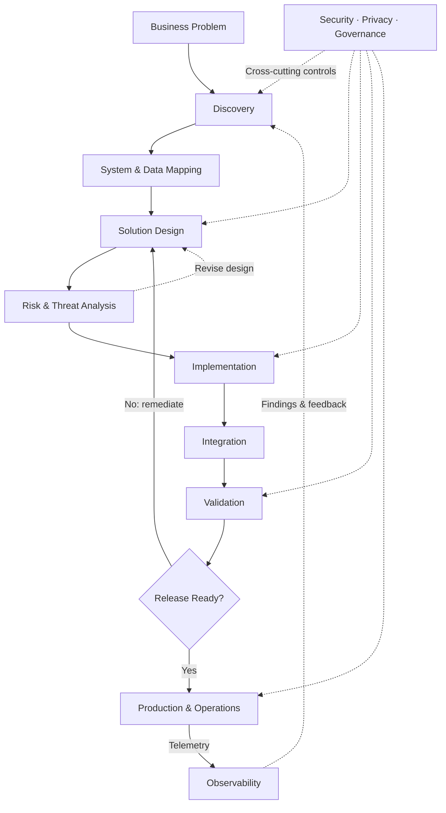

<div align="center">

# `ZECH://CONTROL-PLANE`

### Ezequiel Nascimento

`SENIOR SYSTEMS ANALYST` · `SOLUTION ARCHITECTURE` · `ENTERPRISE TECHNOLOGY`

**enterprise systems / integrations / security-by-design / automation / responsible AI**

[](https://www.linkedin.com/in/zechbirth)
[](https://github.com/zechbirth)

</div>

---

```console
zech@github:~$ ./bootstrap

[ PROFILE ] enterprise_systems ......... ACTIVE
[ FOCUS   ] solution_architecture ...... ACTIVE
[ FOCUS   ] systems_integration ........ ACTIVE
[ FOCUS   ] security_by_design ......... ACTIVE
[ FOCUS   ] automation ................. ACTIVE
[ LEARNING] public_course_records ...... 08

control plane initialized.
```

## `01 / SYSTEM.IDENTITY`

```toml
[operator]
name = "Ezequiel Nascimento"
handle = "@zechbirth"

[role]
primary = "Senior Systems Analyst"
practice = "Technology Consulting & Solution Design"

[mission]
statement = """
Turn complex business needs into secure, traceable,
maintainable and operationally reliable systems.
"""
```

I work where **business requirements become technical decisions** — connecting enterprise applications, integrations, identity, data flows and operational constraints.

My approach spans **discovery, architecture, implementation, integration, validation and operations**, with security, privacy and governance embedded throughout the lifecycle.

---

## `02 / EXECUTION.PIPELINE`



**How to read this model**

- **Security, privacy and governance are cross-cutting controls**, not a one-time approval after development. They apply to every phase, even where an individual arrow is omitted for readability.
- **Risk analysis is iterative.** An unacceptable risk triggers redesign; validation or release-readiness failures require remediation before deployment.
- **Production is not the finish line.** Runtime telemetry feeds observability, incident analysis and the next discovery cycle.
- **Release readiness** covers evidence, change approval, deployment planning, rollback and operational ownership as appropriate to the environment.

---

## `03 / PROBLEM.SPACES`

Representative areas of my work, described without exposing proprietary systems, data or implementation details:

| CONTEXT | ENGINEERING CONCERNS | TYPICAL CONTRIBUTIONS |
| --- | --- | --- |
| **Enterprise HR ecosystems** | SAP, corporate portals, legacy interfaces and workflow dependencies | System mapping, change-impact analysis, interface troubleshooting and solution design |
| **APIs & connected workflows** | Authentication, authorization, data contracts, orchestration and partial failures | Integration analysis, error handling, traceability and validation strategies |
| **Secure operations** | Data exposure, access boundaries, vulnerabilities and continuity | Security reviews, log analysis, incident investigation and operational readiness |

The emphasis is on **how systems behave across boundaries**: who can access them, what they depend on, how they fail, and how teams can safely change them.

---

## `04 / CAPABILITY.REGISTRY`

| DOMAIN | CAPABILITIES |
| --- | --- |
| `SOLUTION ARCHITECTURE` | solution design · dependency mapping · technical decisions · trade-off analysis |
| `ENTERPRISE SYSTEMS` | SAP · HR technology · corporate platforms · legacy ecosystems |
| `INTEGRATION` | REST APIs · interfaces · orchestration · data exchange · failure handling |
| `SECURITY` | identity and access · secure design · vulnerability analysis · data protection |
| `AUTOMATION` | Python · Power Platform · workflow automation · internal tools |
| `DATA & OPERATIONS` | SQL · data flows · auditability · monitoring · root-cause analysis |
| `AI & CONTINUOUS LEARNING` | machine learning · AI product management · AI agents · Responsible AI |

*These are domains of work and study, not claims of certification or equal proficiency in every tool.*

---

## `05 / STACK.REGISTRY`

```text
platforms-and-enterprise/
├── SAP & HR technology
├── Microsoft 365 / SharePoint
├── Power Platform
└── Microsoft Azure
    ├── App Services
    └── Key Vault

engineering-and-data/
├── Python
├── JavaScript / TypeScript
├── .NET
├── SQL
└── REST APIs

architecture-and-operations/
├── Solution design & dependency mapping
├── Identity, authorization & trust boundaries
├── Secure integration & data flows
├── Logging, telemetry & incident analysis
└── Governance, change impact & continuity

learning-and-exploration/
├── Machine Learning
├── AI product design
├── AI agents
└── Responsible AI
```

<details>
<summary><code>expand /stack/visual.registry</code></summary>

<div align="center">


</div>

</details>

---

## `06 / ARCHITECTURE.MODE`

```yaml
solution:
  discover:
    - business context and expected outcomes
    - existing architecture and ownership
    - system dependencies and data classification
    - trust boundaries and privacy requirements

  design:
    - solution options and technical trade-offs
    - identity, authorization and API contracts
    - data flows, failure modes and recovery paths
    - scalability, availability and performance needs
    - logging and observability requirements

  validate:
    - security and threat-related risks
    - functional and integration behavior
    - data handling and auditability
    - operational impact and test evidence

  release:
    - change approval and deployment readiness
    - rollback and recovery approach
    - documentation and operational ownership

  operate:
    - telemetry, alerts and investigation
    - incident analysis and root-cause learning
    - feedback into discovery and design

  never_assume:
    - "an integration is always available"
    - "user input is trustworthy"
    - "a dependency will never change"
    - "production behaves like development"
```

---

## `07 / DESIGN.FOR.FAILURE`

```text
What if the API is unavailable?
What if a token or secret is exposed?
What if a user's access is revoked mid-process?
What if the source system changes unexpectedly?
What if an integration partially succeeds?
What if a payload is malformed or duplicated?
How is the event traced, retried or safely reversed?
Who is alerted when something fails outside business hours?
```

**Reliability, security and observability are architecture concerns — not afterthoughts.**

---

## `08 / LEARNING.CREDENTIALS`

```console
zech@github:~$ learning --list

security ..................... 03 records
architecture ................ 01 record
enterprise .................. 01 record
ai-and-machine-learning ..... 02 records
ethics ...................... 01 record

08 course / program records
```

The entries below link to **course or program completion records**. Course certificates and professional-body certifications are different credentials. In particular, the Packt SSCP preparation specialization **is not an ISC2 SSCP certification**.

| DOMAIN | COURSE / PROGRAM | PROVIDER | COMPLETED | RECORD |
| --- | --- | --- | --- | --- |
| `SECURITY` | **Security and Ethical Hacking Specialization** | University of Colorado Boulder | Jul 2026 | [View](https://www.coursera.org/account/accomplishments/specialization/MBWC3BLK5HWE) |
| `SECURITY` | **Cyber Security — Technology and Governance Specialization** | University of London | Jul 2026 | [View](https://www.coursera.org/account/accomplishments/specialization/S5C3LO2DLGSK) |
| `SECURITY` | **Systems Security Certified Practitioner (SSCP) — preparation specialization** | Packt | Jul 2026 | [View](https://www.coursera.org/account/accomplishments/specialization/6K0PI6RM0JHG) |
| `ARCHITECTURE` | **Software Design and Architecture** | University of Alberta | Jul 2026 | [View](https://www.coursera.org/account/accomplishments/specialization/HJ5SN309LCAO) |
| `ENTERPRISE` | **SAP Technology Consultant Professional Certificate** | SAP | Jul 2026 | [View](https://www.coursera.org/account/accomplishments/professional-cert/YUOP4VIHY6BJ) |
| `AI / ML` | **Machine Learning Specialization** | Stanford Online / DeepLearning.AI | Jun 2026 | [View](https://www.coursera.org/account/accomplishments/specialization/XZ95HNBJ8GCD) |
| `AI / ML` | **AI Product Management Specialization** | Duke University | Jul 2026 | [View](https://www.coursera.org/account/accomplishments/specialization/NJ75BQTI6MZX) |
| `ETHICS` | **Computing, Ethics, and Society Specialization** | University of Colorado Boulder | Jul 2026 | [View](https://www.coursera.org/account/accomplishments/specialization/2DJ807QGY64L) |

<details>
<summary><code>expand /credentials/record.ids</code></summary>

```text
MBWC3BLK5HWE   Security and Ethical Hacking
S5C3LO2DLGSK   Cyber Security — Technology and Governance
6K0PI6RM0JHG   SSCP preparation specialization (Packt)
HJ5SN309LCAO   Software Design and Architecture
YUOP4VIHY6BJ   SAP Technology Consultant
XZ95HNBJ8GCD   Machine Learning
NJ75BQTI6MZX   AI Product Management
2DJ807QGY64L   Computing, Ethics, and Society
```

</details>

---

## `09 / OPERATING.PRINCIPLES`

```text
01  understand before implementing
02  map dependencies before changing
03  make trust boundaries explicit
04  assess risks and design for failure
05  validate decisions with evidence
06  automate repetitive work responsibly
07  instrument and learn from production
08  keep people accountable for technology
```

Good architecture makes dependencies visible. Good security makes trust explicit. Good operations turn failures into evidence for improvement. And responsible AI should increase human capability without reducing human accountability.

---

## `10 / SYSTEM.STATUS`

```console
zech@github:~$ status --profile

enterprise_systems .......... PRACTICE
solution_architecture ....... PRACTICE
integrations ................ PRACTICE
security_by_design .......... PRACTICE
automation .................. PRACTICE
ai_and_responsible_tech ..... LEARNING + PRACTICE
course_records .............. 08 PUBLIC LINKS

operating_mode .............. CONTINUOUS IMPROVEMENT
```

---

<div align="center">

### `ESTABLISH CONNECTION`

[LinkedIn](https://www.linkedin.com/in/zechbirth) · [GitHub](https://github.com/zechbirth)

<sub>Further reading on responsible AI: <a href="https://www.wemustactnow.ai">We Must Act Now</a> (external initiative; not an affiliation claim).</sub>

<br>

<sub>BUILD SYSTEMS THAT SURVIVE CONTACT WITH REALITY.</sub>

</div>
