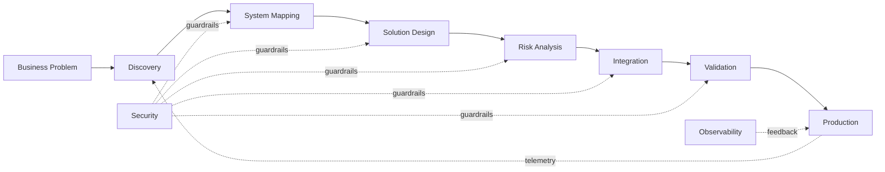

<div align="center">

# `ZECH://CONTROL-PLANE`

### Ezequiel Nascimento

`TECHNOLOGY CONSULTANT` · `SENIOR SYSTEMS ANALYST` · `RESPONSIBLE AI`

**enterprise systems / architecture / security / automation / intelligence**

<br>

[](https://www.linkedin.com/in/zechbirth)
[](https://github.com/zechbirth)
[](https://www.wemustactnow.ai)

</div>

---

```console
zech@github:~$ ./bootstrap

[ OK ] identity.................... EZEQUIEL NASCIMENTO
[ OK ] enterprise_systems......... ONLINE
[ OK ] solution_architecture...... ONLINE
[ OK ] integrations............... ONLINE
[ OK ] automation................. ONLINE
[ OK ] cybersecurity.............. ENFORCED
[ OK ] responsible_ai............. ENABLED
[ .. ] learning_loop.............. CONTINUOUS

system ready.
```

## `01 / SYSTEM.IDENTITY`

```toml
[operator]
name = "Ezequiel Nascimento"
handle = "@zechbirth"

[role]
primary = "Senior Systems Analyst"
mode = "Technology Consultant"

[focus]
architecture = true
enterprise_systems = true
integrations = true
automation = true
cybersecurity = true
responsible_ai = true

[objective]
statement = """
Transform complex business problems into
secure, traceable and reliable digital systems.
"""
```

I work in the layer where **business requirements become technical decisions**.

Not only implementing systems, but understanding how they connect, where they fail, what they expose, how they scale and what happens when something changes.

My work typically crosses:

`business` → `architecture` → `integration` → `security` → `delivery` → `operations`

---

## `02 / EXECUTION.PIPELINE`



```text
INPUT
  business requirement
       │
       ▼
DISCOVER ──► MAP ──► DESIGN ──► SECURE ──► BUILD ──► VALIDATE ──► OPERATE
               │          │          │                       │
               │          │          │                       │
               └──── dependencies    └──── risk              │
                                                              │
                       ◄──────── feedback / telemetry ─────────┘
```

---

## `03 / CAPABILITY.MATRIX`

| DOMAIN         | SYSTEM CAPABILITY                                              |
| -------------- | -------------------------------------------------------------- |
| `ARCHITECTURE` | solution design · dependency mapping · technical decisions     |
| `ENTERPRISE`   | SAP · HR technology · corporate platforms · legacy ecosystems  |
| `INTEGRATION`  | REST APIs · interfaces · orchestration · data exchange         |
| `SECURITY`     | identity · access · vulnerability analysis · secure design     |
| `AUTOMATION`   | Python · Power Platform · workflow automation · internal tools |
| `DATA`         | SQL · data flows · governance · operational analytics          |
| `AI`           | machine learning · AI products · agents · Responsible AI       |
| `OPERATIONS`   | incident analysis · root cause · continuity · monitoring       |

---

## `04 / ARCHITECTURE.MODE`

```yaml
solution:
  start_with:
    - business context
    - existing architecture
    - dependencies
    - data flows
    - trust boundaries

  validate:
    - security
    - identity
    - scalability
    - integration contracts
    - failure scenarios
    - operational impact

  deliver:
    - architecture
    - implementation
    - evidence
    - documentation
    - observability

  never_assume:
    - "the integration will always be available"
    - "the user input is trustworthy"
    - "the dependency will never change"
    - "production behaves like development"
```

---

## `05 / STACK.REGISTRY`

```text
enterprise/
├── SAP
├── HR Technology
├── Microsoft 365
├── SharePoint
└── Power Platform

cloud/
├── Microsoft Azure
├── App Services
├── Key Vault
├── Identity
└── Cloud Integrations

engineering/
├── Python
├── JavaScript
├── TypeScript
├── .NET
├── REST APIs
└── SQL

security/
├── Identity & Access
├── Application Security
├── Secure Architecture
├── Vulnerability Analysis
└── Governance

intelligence/
├── Machine Learning
├── AI Products
├── AI Agents
├── Automation
└── Responsible AI
```

<details>
<summary><code>expand /stack/visual.registry</code></summary>

<br>

<div align="center">


</div>

</details>

---

## `06 / FAILURE.IS.A.FEATURE`

I care about the part of architecture diagrams usually omitted:

```text
What if the API is unavailable?

What if the token leaks?

What if the employee no longer exists?

What if the source system changes?

What if authorization fails?

What if the payload is malformed?

What if the integration partially succeeds?

What happens at 03:00 when nobody is watching?
```

Because a system is not defined only by its happy path.

**Reliability is architecture.
Security is architecture.
Observability is architecture.**

---

## `07 / SECURITY.MODEL`

```python
def ship(solution):
    understand(solution.context)
    map(solution.dependencies)
    identify(solution.trust_boundaries)

    validate(
        authentication=True,
        authorization=True,
        data_exposure=True,
        failure_modes=True,
        auditability=True
    )

    deploy(solution)

    while solution.is_running:
        observe()
        investigate()
        improve()
```

---

## `08 / CURRENT.VECTOR`

```text
                          ┌──────────────────────┐
                          │  ENTERPRISE SYSTEMS  │
                          └──────────┬───────────┘
                                     │
                    ┌────────────────┼────────────────┐
                    │                │                │
                    ▼                ▼                ▼
             ARCHITECTURE       CYBERSECURITY      AUTOMATION
                    │                │                │
                    └───────────┬────┴────┬───────────┘
                                │         │
                                ▼         ▼
                              DATA       AI
                                │         │
                                └────┬────┘
                                     ▼
                             DIGITAL PRODUCTS
```

The direction is increasingly clear:

**systems that are intelligent, integrated and automated — without sacrificing security, governance or human responsibility.**

---

## `09 / LEARNING.LOG`

```diff
+ Machine Learning
+ AI Product Management
+ SAP Technology
+ Software Design & Architecture
+ Cybersecurity
+ Technology Governance
+ Statistics & Data Science

> status: continuous
> strategy: learn → build → break → understand → improve
```

---

## `10 / OPERATING.PRINCIPLES`

```text
01  understand before implementing
02  map dependencies before changing
03  reduce implicit trust
04  design for failure
05  make decisions traceable
06  automate repetitive work
07  measure what reaches production
08  keep humans accountable for technology
```

---

<details>
<summary><code>cat /etc/zech/manifesto</code></summary>

<br>

Technology should not become more complex simply because the problem is complex.

Good systems make complexity **observable**.

Good architecture makes decisions **understandable**.

Good security makes trust **explicit**.

Good automation removes repetition without removing **accountability**.

And good artificial intelligence should increase human capability without decreasing human responsibility.

</details>

---

```console
zech@github:~$ status

architecture ............... ACTIVE
security ................... ACTIVE
automation ................. ACTIVE
responsible-ai ............. ACTIVE
curiosity .................. UNLIMITED

zech@github:~$ _
```

<div align="center">

### `ESTABLISH CONNECTION`

[LinkedIn](https://www.linkedin.com/in/zechbirth)
·
[GitHub](https://github.com/zechbirth)
·
[We Must Act Now](https://www.wemustactnow.ai)

<br><br>

<sub>
BUILD SYSTEMS THAT SURVIVE CONTACT WITH REALITY.
</sub>

</div>
